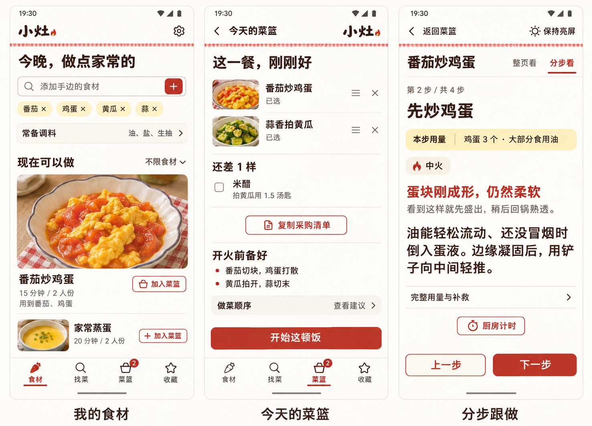
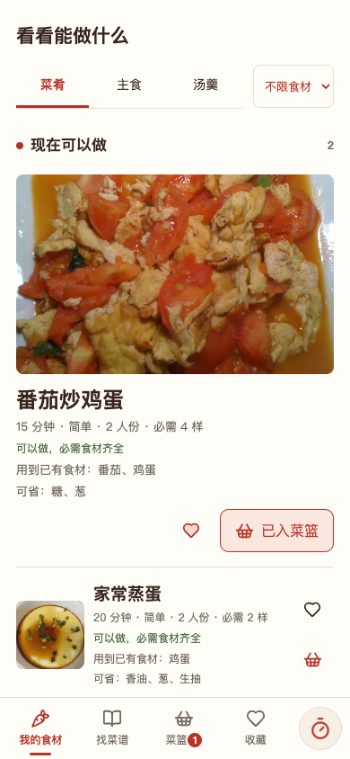
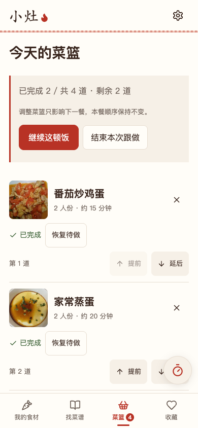
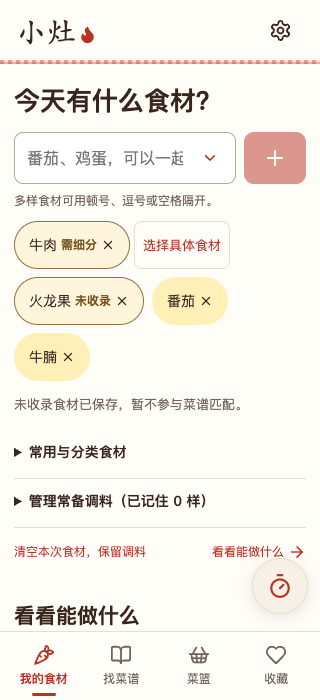
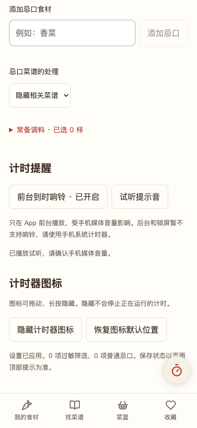
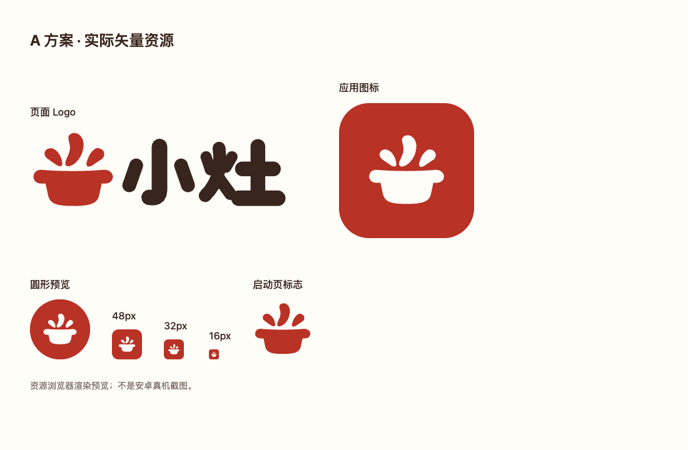
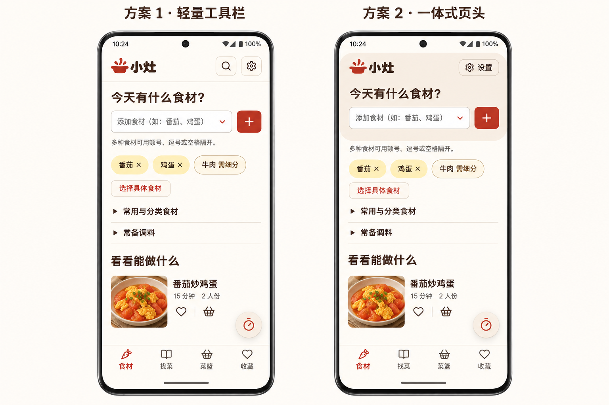
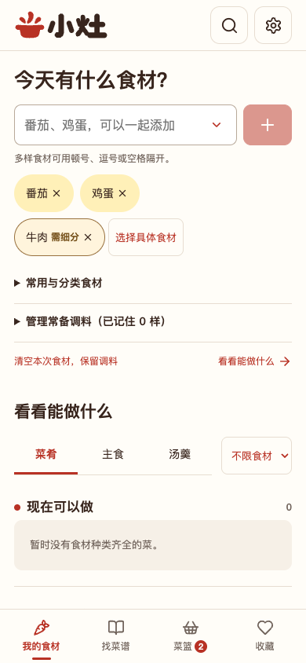

# 小灶：家常厨房界面与交互说明

> 当前开发版的五个底栏入口为我的食材、找菜谱、菜篮、饭友圈、我的。收藏、账号与厨房设置从「我的」进入。顶部保留设置快捷入口。

[改版前实测、设计方案与实装截图](design/mobile-refresh/README.md)

## 从今晚选菜到开火跟做（独立分支审查）

选完食材后，已选标签下直接给出当前分类与筛选下的一道菜。必需食材齐全时显示可做数量，缺料时列出实际要补的食材；点菜名进入详情。列表用文字和底色区分可做、缺料，加入菜篮有选中反馈。

菜篮的顺序入口、未记食材和本餐进度各有明确位置。分步页用分段进度条和步数定位当前动作，保留火力、用量和可观察状态；“接下来”取自同一道菜的下一步或本餐可继续的下一道。底部“下一步”占较宽的触控区域，文字在切换时保持清晰，减少动态效果时直接切换。

390 × 844 触控视口实测，左侧改前、右侧改后：[食材齐全](design/opus-kitchen/ready.webp) · [缺料和选菜](design/opus-kitchen/selection.webp) · [菜篮和顺序](design/opus-kitchen/basket.webp) · [分步跟做](design/opus-kitchen/cooking.webp)。

## 窄屏浏览与跟做

[运行验收与前后对照](design/kitchen-ui/implemented/verification.md)

找菜、收藏和饭友圈编辑器默认把计时器停在页头预留位置。拖动可改位置，长按可隐藏，键盘 Home 可恢复默认停靠。找菜清空键恢复输入焦点并保留分类。长缺料清单在列表显示数量和前两样，详情保留完整清单与饮食限制。

食材工作区在 760px 起分栏，录入区最低 300px，推荐区使用剩余宽度。菜篮先提供顺序建议，再列出实际顺序。分步跟做把动作正文移至步名下，低高度横屏并排显示动作和用量。底栏选中、详情进入与管理底单提供短过渡，减少动态效果设置可直接切换。

## 找菜谱分类筛选

找菜谱默认选中「全部」。修改或清空关键词时保留所选分类，即使当前没有结果。分类标签始终显示「全部」，点它可以扩大搜索范围并保留关键词。「浏览全部菜谱」会清除搜索和筛选。收藏仍独立保存搜索和筛选。

## 1.7.0 饭友圈

[页面与交互约定](COMMUNITY_INTERACTIONS.md)先于实现写入。底部新增第五项饭友圈，保留原顶部栏、原色与悬浮计时器；通过下载接入原菜谱详情、菜篮与跟做，不替换内置内容。

已查看浏览器实际截图：[编辑页](design/community-1.7.0/editor-390.png)、[下载菜谱跟做页](design/community-1.7.0/cooking-390.png)。使用自动测试的示例内容，不是生成设计图或安卓真机截图。

## 1.6.3 左侧轻量工具栏（实现前约定）

- 用户已选择上一轮效果图左侧方案。保留 A「小字蒸汽锅」和原配色；页面顶部为紧凑品牌行，Logo 左对齐，找菜和设置以两个同尺寸圆角按钮集中在右侧。原格纹线改为细浅色分隔线，正文仍与顶部栏分开。
- Logo 使用既有矢量资源，显示宽 120px、点击区至少 48px 高。两个快捷入口均为 48×48px，中间留 8px；窄屏保持单行，遵守原有系统安全区。
- 放大镜进入现有找菜页，不自动清空搜索／筛选，也不抢先弹出键盘；齿轮进入厨房设置；点击 Logo 返回食材页。使用原导航机制，浏览器／安卓返回、收藏与找菜的独立筛选继续保留。
- 当前找菜或设置入口有选中样式及读屏状态，键盘焦点与按下反馈可见。底部四项导航、食材输入行为和悬浮计时／长按隐藏不变；跟做时继续隐藏全局顶栏，保留原有返回与亮屏工具栏。
- 效果图只决定顶部布局，不替换现有菜品图片或照抄生成文案。方案 2「一体式页头」留作未采用的历史提案。

## 1.6.2 标志落地与顶部栏提案（先说明后实现）

- 用户已确认 A「小字蒸汽锅」，保留番茄红 `#b83225`、暖白 `#fffdf8`、深棕 `#38251d`。标志由三笔蒸汽与一体锅身构成，文字采用固定矢量笔画，避免安卓缺少字体后变形。按确认稿重建可缩放轮廓，不把整张生成展示板裁成图标。
- 正式替换范围：安卓桌面／圆形／主题单色图标、启动页标志、网页左上角 Logo 与浏览器图标。桌面红底白图；启动页暖白底红图；页面红锅与深棕文字。桌面核心图形保留裁切余量，前景图层透明，不再重复画满红色背景。
- 左上角仍是回到食材页的链接，读屏名称保留“小灶”，可点击区域至少 48px 高。设置入口、原顶部格纹、页面标题、底部四项导航、悬浮计时与长按隐藏此次不改变；跟做页面继续沿用现有导航。
- 顶部栏另提供两个待选效果稿。方案 1「轻量工具栏」：Logo 左对齐，右侧聚合找菜／设置入口，浅色工具区和细分隔线替代格纹。点找菜进入现有找菜页，点设置进入厨房设置，输入时不自动跳转。
- 方案 2「一体式页头」：在食材页将品牌行、页面标题、输入框归入同一浅暖色区域；右上角保留有文字的设置按钮，输入／添加／展开建议的交互仍与现有功能相同。保持顶部总高度接近现状，避免扩大装饰留白。
- 两个顶部栏仅供选择，未据生图增删业务功能。图稿内照片与文字只作排版示意，后续实现继续使用原菜品图片与真实状态；不能将生成图中的位置或选中态直接当作业务规则。

## 1.6.1 实现前的交互约定

- 沿用确认稿的暖白、番茄红、黄底用量与现有实拍，不重新设计页面。菜篮完成状态放在菜名下方独立一行，避免与删除按钮争抢窄屏宽度；使用文字和勾选图标，不仅让照片变灰。
- 完成页“回到菜篮”仅导航，保留本餐 ids、done 和当前步骤。菜篮首部显示“已完成 X / 共 Y 道 · 剩余 Z 道”；继续入口恢复未完成的当前菜，否则选择符合饮食设置的下一道。被限制的菜不能算完成。
- 完成菜保留，提供“恢复待做”。只撤销所选菜的完成记录；若当前就是这道已完成菜，重置到第 1 步，否则不打断另一道正在做的菜。全部完成后保留进度，开始新一餐须明确确认。结束本次跟做仍需原有确认。
- 本餐顺序保持启动时的快照；调整菜篮只影响下一餐。新加入菜显示“下一餐”；已从菜篮移走但属于本餐的菜在本餐补充清单中保留状态和恢复入口，不能因移除操作消失。
- 食材标签持续显示已识别、未收录或需细分状态。已识别沿用原外观；未收录显示文字和柔和边框，保留删除。笼统的牛肉／猪肉／鸡肉／鱼／豆腐提供“选择具体食材”入口，打开有取消按钮的对话框，点击一个选项才替换，去重且不改变其他食材；取消不改数据。删除与选择是独立按钮，不嵌套。
- “未收录”解释为已保存、暂不参与匹配；“需细分”解释为选择实际部位／种类。别名先归一化，不把未知食材自动猜成已收录食材。
- 设置新增“前台到时响铃”（默认开启，旧数据升级采用默认值）与试听。用户触控时准备音频；到时重复播放短提示音，停止、暂停、延长、关闭开关、离开前台时停止声音。仅关闭弹窗或隐藏／移动图标不结束计时，也不关闭前台声音。音频受阻时保留视觉提醒和明确的手动重试入口。
- 声音控制器放在整个应用层，切页不重复创建响铃。回到前台发现未确认的过期计时可继续提醒；本轮没有后台／锁屏提醒服务，界面明确说明。浏览器自动化验证调度与停止，实际外放音量和安卓锁屏由真机确认。

设计依据：用户确认的暖白、番茄红三屏设计稿（食材／菜篮／分步跟做）。本说明先于实现编写。现有 React + Capacitor 架构保留，按安卓手机使用场景实现。

## 视觉规则

- 暖白 `#fffdf8` 页面、深棕 `#38251d` 正文、番茄红 `#b83225` 主操作、蛋黄 `#fff0b8` 用量／已选食材、灰棕 `#71645c` 次要文字、浅棕 `#e7ddd1` 分隔线。
- 标题使用系统中文字体的粗体；品牌可用系统圆润／手写字体回退。安卓不依赖 iOS 独有字体，不下载网络字体。正文保持易读。
- 1.6.3 页头使用 A 标志和右侧找菜／设置快捷入口，细分隔线替代旧格纹。内容采用留白与分隔线，照片小圆角，取消大片彩色面板与重复卡片。没有口号、虚构评价、额外营销文案。
- 图片只用现有菜品资源。保留原图完整构图要求、放大预览、来源和失败时的文字入口。首道可做菜使用较大的照片；其余列表紧凑显示。

## 页面和动作

### 共用导航

底栏依次为食材、找菜、菜篮、收藏；当前页面有文字／线条反馈，菜篮显示数量。设置移到页头右侧，仍可访问全部饮食限制、常备调料、常用食材和计时器设置。页头品牌返回食材页。

1.6.0 按用户要求恢复独立悬浮计时器：默认在右下方、底栏上面，点击打开，拖动换位置并保存，长按约 650 毫秒隐藏；厨房设置中恢复。隐藏不取消计时，暂停／继续／结束和到点提示保留。分步页仍使用全宽上一步／下一步，计时器默认浮在按钮上方；屏幕旋转或尺寸变化后限制在安全区内。

### 我的食材

标题、输入框、已选食材在最前。输入保留别名、批量添加、建议列表、去重和错误反馈；点已选项上的叉移除。常用／分类选择器折叠在一个明确入口内，展开后仍能管理、排序、查找和选择。常备调料独立折叠并显示已选数量。清空本次食材和撤销保留，不能影响调料、菜篮、收藏、计时和跟做进度。

推荐区保留菜肴／主食／汤分类，以及优先用掉某种食材。列表显示缺料、匹配食材、可省配料、用时和份数。可做列表第一道使用大图，食材不足列表不冒充可做。点菜名／图片进入详情；收藏、加入／移出菜篮分别有独立按钮与选中反馈。仅油盐等调料时仍显示添加食材的空状态。

### 找菜、收藏、详情与设置

沿用相同排版和配色。找菜和收藏各自记住搜索／筛选。1.6.0 输入关键词后搜索全部分类，避免牛排、主食或汤被上次分类挡住；随后仍可主动选分类。菜名／别名优先于配料匹配，牛扒与牛排、意粉与意面互通，牛肉检索涵盖牛排与牛腩等部位；这些搜索词不把库存中的不同肉类部位视为可替换。收藏只检索已收藏的菜。返回／刷新保留查询与人工筛选；“浏览全部菜谱”清除限制后显示 200 道。保留分类、时间、难度、少配料、清空筛选和无结果反馈。详情保留看备料、收藏、菜篮、原始用量说明、步骤、教学、营养、来源和照片署名。看备料在窄屏占整行。设置中的过敏限制与原有阻止开做逻辑保持有效。

### 菜篮

展示所选菜的真实缩略图、菜名、份数和用时。点菜名进入详情；移除按钮独立；用明确的“提前／延后”调整顺序，首尾相应按钮禁用。设计图的拖动把手不被当成已实现的拖拽功能。

缺料摘要、采购清单复制、全部备料／只看缺料、各菜分别用量和做菜顺序建议全部保留。复制失败展示可选择文本；复制成功给出状态反馈。图中采购复选框不实现成虚构的库存核销操作。顺序建议须预览并主动采用，可撤销；修改菜篮不改变进行中的一餐。

开始／继续这顿饭始终容易找到；长菜篮时不能要求滑过所有内容才开做。结束跟做、替换当前跟做仍经现有确认，取消保留进度与计时。食材未记全仍可确认实物后开做；饮食限制导致不可做时，说明原因并禁用开始。

### 跟做

顶部返回保留当前步骤；亮屏按钮展示请求状态及失败／重试说明。整页看与分步看是同一份进度，切换和重载都不丢失当前位置。

分步模式顺序：步骤序号、标题、本步用量（黄底）、火力、可观察状态、原步骤正文、该步骤计时／核对补充、完整用量与补救说明。用量、火力和状态来自已有逐步核对数据；无数据不补写。状态不能只靠红色区分，始终带标签。计时须用户主动启动，不因进入步骤自动开始。

上一步／下一步固定在手机底部；第一步的上一步返回备料，最后一步显示完成这道菜。正文留足底部空间，长步骤和补充说明都能滚动读完。整页模式保留每步书签、独立步骤计时及完成入口。完成后仍可继续本餐下一道或返回菜篮。

## 安卓适配和验收

- 主要触控目标至少 48 CSS px；分步主操作至少 52 px；使用真实按钮、链接、标签和状态语义，键盘也可操作。
- 适配 320、360、390、412 宽度以及横屏；尊重系统上下左右安全区。缩放／长文字可换行，页面不横向溢出。
- 分步底栏不遮挡正文、计时器或焦点；软键盘出现后输入仍可滚动到可见区域。系统返回先关闭弹窗，再返回历史，根页按原逻辑最小化。
- 保留本地存储结构和原有 99 道菜的步骤／计时位置，新增 101 道后共 200 道，旧版本用户无需重置。菜篮与收藏可保存全部 200 道，食材清单支持最多 500 项，不截断扩充后的食材种类。
- 用浏览器模拟手机触控、截图审查、无障碍扫描和现有回归测试验收；实际安卓设备的输入法、系统返回、锁屏行为需要与模拟测试区分报告。

## 实现核对（1.5.0）

- 已移除页头口号、重复食材标题及重复说明；保留批量输入方法、错误、缺料、过敏和食安等有操作意义的信息。
- 设计稿中的三屏已映射到实际路由。四项导航之外仍保留厨房计时工具；菜篮底部固定开始入口；分步时换成上一步／下一步。设置从底栏移到页头，菜篮图片读取现有资源。
- 常用／分类食材默认折叠；推荐区的分类和优先食材合并为一行；空列表和缺料列表保持原有含义。先清空再添加新食材时，旧反馈不继续显示；撤销仍保留。
- 返回与常亮栏在跟做页滚动时保留；较高屏幕切换步骤从页首读起，短屏把当前步骤定位在返回栏下方。状态栏安全区有不透明背景，避免滚动文字穿入。
- 分步用量、火力、状态与原正文并列保留。没有照抄图中的鸡蛋数量、做菜时长、缺料数或假定的拖拽／采购勾选功能。
- 下面是生产页面的实际截图，包含已有照片与原始菜谱内容。截图来自浏览器手机模拟，并非安卓系统截屏。

| 食材入口 | 推荐区 | 菜篮 | 分步跟做 |
| --- | --- | --- | --- |
|  |  |  |  |

[320 像素短屏跟做](design/cooking-320.png) · [横屏跟做](design/cooking-844.png) · [找菜](design/search-390.png) · [详情](design/detail-390.png) · [设置](design/settings-390.png)

## 1.6.0 复查

恢复悬浮计时与跨分类搜索后的截图：

两图来自实际运行，包含已有菜品照片与真实数据。320／390／412 宽竖屏与 844×390 横屏通过触控回归。上文既有 1.5.0 核对图仅记录当时布局，不覆盖本文开头的最新计时器行为说明。

## 1.6.1 实现核对

菜篮状态独立成行，完成状态与恢复操作并列；返回后保留 2／4 道进度，继续进入未完成菜。未收录与需细分均有文字提示，具体部位由用户选择。声音开关和试听放在厨房设置内；原悬浮图标和长按隐藏交互不变。下列图片为实际生产页面的浏览器手机模拟截图，已逐张检查。

| 菜篮进度（390px） | 食材标记（320px） | 前台声音设置（390px） |
| --- | --- | --- |
|  |  |  |

98 项单元测试、409 项浏览器回归与安卓构建通过，具体覆盖和真机限制见[测试记录](TEST_REPORT.md)。

## 1.6.2 标志落地核对

确认稿与正式资源分开保留。正式资源使用统一路径生成，包含网站 Logo／图标和安卓前景／单色／启动页／旧系统图标；不依赖字体，也不包含生成稿背景纹理。以下是代码中实际矢量资源的浏览器渲染，16／32／48px 为真实 CSS 尺寸，不是生图标注。

[320px 实际页面](design/brand-1.6.2/pantry-320.png) · [390px 实际页面](design/brand-1.6.2/pantry-390.png) · [412px 实际页面](design/brand-1.6.2/pantry-412.png) · [用户确认的 A 方案](design/brand-1.6.2/approved-logo-A.png)

顶部栏仅作提案：

以上为 1.6.2 时的提案；1.6.3 已按用户选择采用左侧方案 1，方案 2 未实现。效果图中的菜品图仅为生成示意，实装继续使用现有图片。交互约定见本文开头；生成说明见同目录 `header-proposal.json`。

## 1.6.3 顶部栏实现核对

新 Logo 与两个快捷入口均沿同一中心线排列，窄屏不换行。快捷入口使用真实链接，当前页面有选中状态；搜索入口的读屏名称为“打开找菜页”，与“搜索菜谱”输入框区分。四种尺寸检查点击区域、安全区、搜索条件与返回恢复，并保留原有四项底部导航。

[320px 小屏](design/header-1.6.3/pantry-320.png) · [412px 手机](design/header-1.6.3/pantry-412.png) · [844px 横屏](design/header-1.6.3/pantry-844.png)

以上来自本地生产构建的浏览器手机模拟，非生图或安卓真机截图。完整验证结果见[测试记录](TEST_REPORT.md)。

## 全页面优化分支审查

以下对照来自 390 × 844 的手机尺寸浏览器。审查时可以沿同一份菜谱走完搜索、阅读、下载和离线跟做，再从计时器返回菜谱。

| 界面 | 审查重点 |
| --- | --- |
| [饭友圈与详情](design/opus-kitchen/all-pages/community.webp) | 清空搜索后可以直接继续输入。详情能快速找到食材、步骤和下载入口。 |
| [下载与编辑](design/opus-kitchen/all-pages/library.webp) | 下载结果在按钮附近反馈。离线打开后仍可阅读步骤。 |
| [计时器](design/opus-kitchen/all-pages/timer.webp) | 各状态都能读清剩余时间，暂停和继续时操作位置稳定。 |
| [我的与设置](design/opus-kitchen/all-pages/profile.webp) | 当前身份、收藏和设置入口容易辨认，小屏文字可换行。 |
| [账号与备份](design/opus-kitchen/all-pages/account.webp) | 切换密码可见性保留输入。备份状态与恢复操作容易区分。 |
