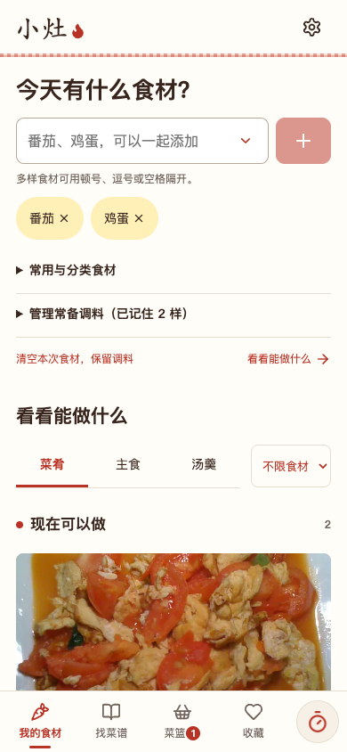

# 小灶：家常厨房界面与交互说明

设计依据：用户确认的暖白、番茄红三屏设计稿（食材／菜篮／分步跟做）。本说明先于实现编写。现有 React + Capacitor 架构保留，按安卓手机使用场景实现。

## 视觉规则

- 暖白 `#fffdf8` 页面、深棕 `#38251d` 正文、番茄红 `#b83225` 主操作、蛋黄 `#fff0b8` 用量／已选食材、灰棕 `#71645c` 次要文字、浅棕 `#e7ddd1` 分隔线。
- 标题使用系统中文字体的粗体；品牌可用系统圆润／手写字体回退。安卓不依赖 iOS 独有字体，不下载网络字体。正文保持易读。
- 页头一条细小红格纹作为品牌记号。内容采用留白与分隔线，照片小圆角，取消大片彩色面板与重复卡片。没有口号、虚构评价、额外营销文案。
- 图片只用现有菜品资源。保留原图完整构图要求、放大预览、来源和失败时的文字入口。首道可做菜使用较大的照片；其余列表紧凑显示。

## 页面和动作

### 共用导航

底栏依次为食材、找菜、菜篮、收藏；当前页面有文字／线条反馈，菜篮显示数量。设置移到页头右侧，仍可访问全部饮食限制、常备调料、常用食材和计时器设置。页头品牌返回食材页。

厨房计时继续占用底部独立小区域，保留点击、拖动、长按隐藏、设置恢复、暂停／继续／结束和到点提示。这是设计图未完整表现的现有功能，实际实现为四个导航入口旁的计时工具。分步跟做时底栏改为上一步／下一步，右侧仍为计时入口；给它预留空间，不能覆盖步骤按钮。

### 我的食材

标题、输入框、已选食材在最前。输入保留别名、批量添加、建议列表、去重和错误反馈；点已选项上的叉移除。常用／分类选择器折叠在一个明确入口内，展开后仍能管理、排序、查找和选择。常备调料独立折叠并显示已选数量。清空本次食材和撤销保留，不能影响调料、菜篮、收藏、计时和跟做进度。

推荐区保留菜肴／主食／汤分类，以及优先用掉某种食材。列表显示缺料、匹配食材、可省配料、用时和份数。可做列表第一道使用大图，食材不足列表不冒充可做。点菜名／图片进入详情；收藏、加入／移出菜篮分别有独立按钮与选中反馈。仅油盐等调料时仍显示添加食材的空状态。

### 找菜、收藏、详情与设置

沿用相同排版和配色。找菜和收藏各自记住搜索／筛选。保留分类、时间、难度、少配料、清空筛选和无结果反馈。详情保留看备料、收藏、菜篮、原始用量说明、步骤、教学、营养、来源和照片署名。看备料在窄屏占整行。设置中的过敏限制与原有阻止开做逻辑保持有效。

### 菜篮

展示所选菜的真实缩略图、菜名、份数和用时。点菜名进入详情；移除按钮独立；用明确的“提前／延后”调整顺序，首尾相应按钮禁用。设计图的拖动把手不被当成已实现的拖拽功能。

缺料摘要、采购清单复制、全部备料／只看缺料、各菜分别用量和做菜顺序建议全部保留。复制失败展示可选择文本；复制成功给出状态反馈。图中采购复选框不实现成虚构的库存核销操作。顺序建议须预览并主动采用，可撤销；修改菜篮不改变进行中的一餐。

开始／继续这顿饭始终容易找到；长菜篮时不能要求滑过所有内容才开做。结束跟做、替换当前跟做仍经现有确认，取消保留进度与计时。食材未记全仍可确认实物后开做；饮食限制导致不可做时，说明原因并禁用开始。

### 跟做

顶部返回保留当前步骤；亮屏按钮展示请求状态及失败／重试说明。整页看与分步看是同一份进度，切换和重载都不丢失当前位置。

分步模式顺序：步骤序号、标题、本步用量（黄底）、火力、可观察状态、原步骤正文、该步骤计时／核对补充、完整用量与补救说明。用量、火力和状态来自已有逐步核对数据；无数据不补写。状态不能只靠红色区分，始终带标签。计时须用户主动启动，不因进入步骤自动开始。

上一步／下一步固定在手机底部；第一步的上一步返回备料，最后一步显示完成这道菜。正文留足底部空间，长步骤和补充说明都能滚动读完。整页模式保留每步书签、独立步骤计时及完成入口。完成后仍可继续本餐下一道或返回菜篮。

## 安卓适配和验收

- 主要触控目标至少 48 CSS px；分步主操作至少 52 px；使用真实按钮、链接、标签和状态语义，键盘也可操作。
- 适配 320、360、390、412 宽度以及横屏；尊重系统上下左右安全区。缩放／长文字可换行，页面不横向溢出。
- 分步底栏不遮挡正文、计时器或焦点；软键盘出现后输入仍可滚动到可见区域。系统返回先关闭弹窗，再返回历史，根页按原逻辑最小化。
- 保留本地存储结构、99 道菜、全部步骤和计时数据，旧版本用户无需重置。
- 用浏览器模拟手机触控、截图审查、无障碍扫描和现有回归测试验收；实际安卓设备的输入法、系统返回、锁屏行为需要与模拟测试区分报告。

## 实现核对（1.5.0）

- 已移除页头口号、重复食材标题及重复说明；保留批量输入方法、错误、缺料、过敏和食安等有操作意义的信息。
- 设计稿中的三屏已映射到实际路由。四项导航之外仍保留厨房计时工具；菜篮底部固定开始入口；分步时换成上一步／下一步。设置从底栏移到页头，菜篮图片读取现有资源。
- 常用／分类食材默认折叠；推荐区的分类和优先食材合并为一行；空列表和缺料列表保持原有含义。先清空再添加新食材时，旧反馈不继续显示；撤销仍保留。
- 返回与常亮栏在跟做页滚动时保留；较高屏幕切换步骤从页首读起，短屏把当前步骤定位在返回栏下方。状态栏安全区有不透明背景，避免滚动文字穿入。
- 分步用量、火力、状态与原正文并列保留。没有照抄图中的鸡蛋数量、做菜时长、缺料数或假定的拖拽／采购勾选功能。
- 下面是生产页面的实际截图，包含已有照片与原始菜谱内容。截图来自浏览器手机模拟，并非安卓系统截屏。

| 食材入口 | 推荐区 | 菜篮 | 分步跟做 |
| --- | --- | --- | --- |
|  |  |  |  |

[320 像素短屏跟做](design/cooking-320.png) · [横屏跟做](design/cooking-844.png) · [找菜](design/search-390.png) · [详情](design/detail-390.png) · [设置](design/settings-390.png)
