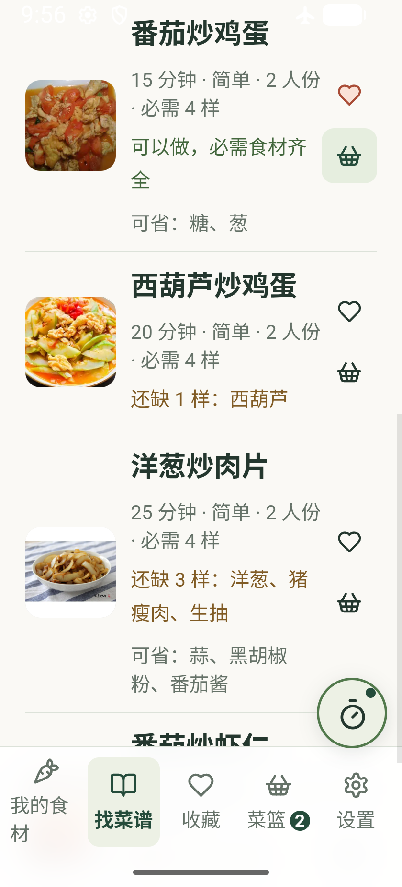
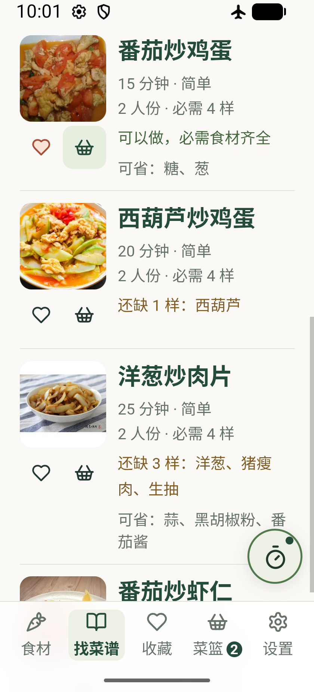
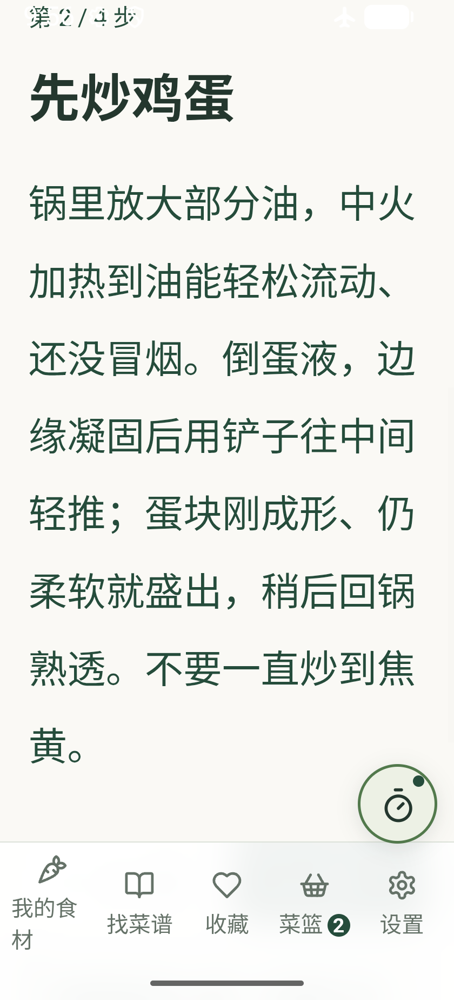
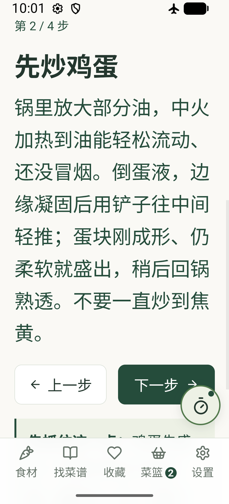

# Android 手机 UI 实测 · 1.3.2

在 Windows 上用 Android Studio 打开 Android 工程、同步 Gradle 并运行到 Medium Phone 模拟器。基线为 `cfdbba9`（1.3.1），更新包为 1.3.2（versionCode 6）。使用同一台电脑的测试密钥覆盖升级。

## 截图对照

两列均为 ADB 抓取的完整设备屏幕。设备为 Android 17 / API 37，x86_64，WebView 149.0.7827.5。默认 1080 × 2400、420 dpi。对照时统一设为 840 × 1848、420 dpi（320dp 宽）、系统字体 130%。验证后恢复默认屏幕、字体和网络。

| 页面与位置 | 1.3.1 | 1.3.2 |
|---|---|---|
| 搜索“番茄”，滚到第一条结果，已收藏且已加入菜篮 |  |  |
| 番茄炒鸡蛋，分步看，第 2 步“先炒鸡蛋” |  |  |

在原版列表中，收藏和菜篮各占右侧一行，文字被夹在照片和按钮之间。改版把两个操作放到缩略图下方，保留各 44 × 44 CSS 像素的点击区域。烹饪时长与难度、份数与必需用料分别成组。在相同大字体设置下，第一道菜的齐料提示可读成一行。

滚动原版页面时，白色系统图标与标题叠在一起；“我的食材”的最后一个字也单独换行。改版在状态栏下铺米白色，使用深色系统图标，窄屏导航显示“食材”。分步正文保留系统字号缩放，行距从 2 倍调到 1.65 倍，收紧段前段后空白。对照截图中，上一步和下一步都进入可见区。

## 实际走过的流程

- 输入“西红柿、鸡蛋”，选食用油、盐，从齐料推荐打开番茄炒鸡蛋。收藏、放大实拍，按系统返回键关闭大图，再加入菜篮。
- 搜索“黄瓜”，加入蒜香拍黄瓜。去菜篮预览并采用顺序，一键开始做饭。从分步页回到备料，再开始这道菜，前进到第 2 步。新版本在清除本次测试数据后重新走通以上流程。
- 启动厨房计时，按系统 Home 键并返回，强停后冷启。用同签名覆盖安装后核对收藏、两道菜单和步骤位置，看到旧计时到点提示并可关闭。随后在新版断网重启模拟器，核对食材、收藏、菜篮、当前步骤和计时截止时间。
- 开飞行模式并关闭 Wi-Fi，系统报告没有默认网络。强停后启动，打开菜谱和实拍。新版在设备 WebView 内逐一解码全部 133 份 WebP（99 道），成功 133/133。浏览器 E2E 另逐菜检查国内做法对照和照片署名。
- 320dp、130% 字体下搜索“手撕包菜（素版）”，详情页、番茄结果列表和长步骤页实测文档宽度均为 320 CSS 像素。点搜索框后 Android 输入法进入输入状态，搜索框仍可见。模拟器显示的是硬件键盘配套输入面板，全尺寸中文软键盘候选栏留待实体手机验证。

## 构建与测试

| 检查 | 基线 | 交付版 |
|---|---:|---:|
| Node 单元测试 | 80/80 | 80/80 |
| Playwright 浏览器 E2E | 283/283 | 284/284 |
| Android | Studio 同步、安装与运行 | Gradle assembleDebug、lintDebug 及覆盖安装通过 |

新增用例检查窄屏的缩略图与按钮位置、点击范围和标题打开详情。App lint 报告 0 错误、4 警告，分别是 1 项依赖版本提示和 3 项资源未使用提示。

实体手机验收重点为全面屏手势和挖孔、中文全键盘下的选词与收起、厨房单手触控、锁屏及厂商省电策略下的计时恢复。应用提供页面内到点提醒。
